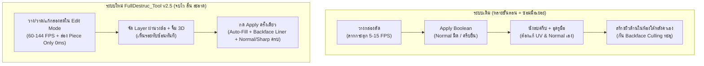

# สรุปผลระบบใหม่ และเปรียบเทียบกับระบบเดิม

กลับไปที่ [[00_Home]] | [[ระบบ_Rust_Engine_และ_GPU_Preview]] | [[ระบบปิดหน้าตัด_และ_ปิดผิวทะลุอัตโนมัติ]] | [[Apple_Bite_v2]]

![[before_vs_after_comparison.jpg]]

> [!success] ภาพรวมผลลัพธ์หลักของระบบใหม่ (`FullDestruc_Tool v2.5`)
> - **ความลื่นตอนลาก/แก้กล่องตัด:** **60–144 FPS** (Main thread ใช้เวลาส่งข้อมูลแค่ `~1.0 ms`, Rust คำนวณเบื้องหลัง `~13–20 ms`)
> - **ความแม่นยำของแสงเงา (Custom Split Normals):** คลาดเคลื่อน **`0.000°`** บนผิวเดิมที่ไม่โดนตัด + คงรูป Quad/UV ครบ
> - **การสลับมุมมอง & ตารางสี:** **`0 ms`** ทันที (สลับ `All / Piece Only แยกตาม Zone / Hole Only` และ `Zone Grid` โดยไม่ต้องคำนวณใหม่)
> - **ลดงานซ่อมโมเดลด้วยมือหลัง Apply:** อุดรูหน้าตัด + ปิดผิวด้านในที่มองทะลุให้อัตโนมัติ

---

## ตารางเปรียบเทียบแบบละเอียด: ระบบเดิม vs ระบบใหม่

| หัวข้อ | ระบบเดิม (Legacy Boolean / Workflow เก่า) | ระบบใหม่ (`FullDestruc_Tool v2.5`) | ดีกว่าอย่างไร |
| :--- | :--- | :--- | :--- |
| **1. เอนจินตัด & ความลื่น** | ใช้ Boolean Modifier ของ Blender คำนวณบน Main thread → ลากกล่องกระตุกหนัก (`5–15 FPS`) หรือค้าง | **Rust Boolean Engine v1.5.1** คำนวณเบื้องหลังแบบ Async (`Latest-Wins`) | ลาก/หมุน/ยืดกล่องได้ลื่น **60–144 FPS** แม้โมเดลมี 7,000–20,000+ โพลีกอน |
| **2. การแสดง Texture ระหว่างตัด** | สลับเป็นสีเทาเรียบๆ หรือกระพริบตอนคำนวณใหม่ มองไม่ออกว่าตัดโดนลายอะไร | **Zero-Switch Multi-Layer PBR GPU Preview** วาดตรงบนการ์ดจอ (รองรับ 4-Layer + UV0/UV1 Mask & Tint) | เห็น Texture จริงของตึกตลอดเวลา ไม่มีจอกระพริบ |
| **3. แสงเงา (Normals & Sharp Edges)** | หลัง Apply ค่า `Custom Split Normals` และ `Sharp Edges` หายหมด ทำให้ผนังมืดและเบี้ยว | ส่งต่อ `loop_normals` ตรงจาก Rust + กู้คืนด้วย `normals_split_custom_set()` และสร้าง `sharp_edge` + `freestyle_edge` | ผิวตึกเดิมสวยคมเหมือนต้นฉบับ **100%** ไม่ต้องมานั่งแก้ Normal ใหม่ |
| **4. หน้าตัด (Cut Caps) บนโมเดลที่ไม่ได้ปิดตัน** | มักเกิดครีบสามเหลี่ยมยื่นแหลมกลางห้องใต้หลังคา หรือหน้าตัดแตก/หาย | **2D Constrained Delaunay Triangulation (CDT)** + Harmonic Diffusion + ตัดครีบสามเหลี่ยม + อุดรูเข็ม | หน้าตัดเรียบ คม ไม่มีครีบยื่นเกะกะกลางห้อง และคำนวณเร็วมาก (`< 4 ms`) |
| **5. ผิวชั้นเดียวที่มองทะลุ (Backface Culling)** | พอตัดเปิดห้องใต้หลังคา จะมองทะลุผนังด้านใน ต้องเข้า Edit Mode นั่งสร้างหน้าปิดเองทีละด้าน (UV ยืดเป็นเส้น) | **`Close See-Through Backfaces`**: ยิง Ray `BVHTree` หาผิวชั้นเดียวที่หันหลังให้รอยตัด → สร้าง **Welded Inner Liner (~2.8 มม.)** อัตโนมัติ | มองเข้าไปในห้องใต้หลังคาแล้วไม่ทะลุ, ไม่มี Z-Fighting, ลาย Box UV สวยไม่ยืด, กดซ้ำไม่ซ้อน |
| **6. ปิดรูหน้าตัดที่เปิดอยู่** | ต้องเข้า Edit Mode เลือกขอบแล้วกด `F` เองทีละรู (UV เพี้ยน + Normal เสีย) | **`Auto-Fill Cut Gaps`** (อัตโนมัติตอน Apply) + ปุ่ม **`Fill Cut Cap`** (กดได้ทั้ง Object Mode และ Edit Mode เลือกขอบ/ผิว) | ปิดเฉพาะรูผนังตันบนแนวตัด **ไม่เผลอปิดหน้าต่าง/ประตู/ห้องกลวง** พร้อมใส่ Cut Material + Box UV ให้ครบ |
| **7. การแก้กล่องตัดใน Edit Mode** | ขยับหน้ากล่องใน Edit Mode แล้วพรีวิวไม่อัปเดต ต้องกด `Tab` ออกก่อน และตัวตึกบังจุดกลางหน้า `*` จนคลิกเลือกยาก | อ่านจุดสดจาก `bmesh.from_edit_mesh` ทุกเฟรม + วาดจุดกลางหน้า (`*`), เส้นขอบ และสีส้มหน้าที่เลือกลอยเด่นเฉพาะตอนอยู่ใน Edit Mode | ปรับเบเวล/ดึงหน้ากล่องใน Edit Mode แล้วรอยตัดขยับตามทันที คลิกเลือกหน้าได้ในคลิกเดียว และกด Apply จากใน Edit Mode ได้เลย |
| **8. การส่องดูเฉพาะชิ้นที่ตัด** | ต้องซ่อนตัวตึกหลักเองใน Outliner แล้วค่อยเปิดคืนทีหลัง | ปุ่ม **`All` \| `Piece Only` \| `Hole Only`** (0 ms) โดย `Piece Only` **แยกแสดงตาม Zone ของกล่องที่เลือกอยู่** | หมุนส่องรอบชิ้นที่ตัดและขยับกล่องแก้รอยตัดไปพร้อมกันได้ลื่นๆ กดสลับ Zone แค่คลิกกล่องอื่น |
| **9. การสลับลำดับ Layer ของ Zone** | ต้องเลื่อนสายตาไปกดปุ่มขึ้น/ลงในแถบด้านข้างหลายครั้ง | **แถบโค้งด้านนอกขวาของเมนูวงล้อ (`▲ Up` / `▼ Down`)** → ชี้คลิกกล่องเป้าหมายในจอ 3D เพื่อแทรกเหนือ/ใต้ทันที | จัดลำดับการทับซ้อนระหว่างกล่องตัดได้ตรงจุดบนจอ 3D พร้อมป้าย `#1 [Zone A]` เรืองแสงชัดเจน |
| **10. ความปลอดภัยของต้นฉบับ & Re-edit** | โฟลเดอร์ `Original` ชอบเด้งมาบัง หรือกด Apply แล้ว Error / ซ้ำซ้อน | **`Protected Vault Shield`** (`fdt_protected = True`) + `Re-edit` เขียนทับสะอาด + `Reset to Original` ล้างคืนต้นฉบับครบทุกกิ่ง | ไม่มีวันทำต้นฉบับพัง กลับไปแก้กี่รอบก็ได้ หรือล้างเริ่มใหม่ได้ในคลิกเดียว |

---

## เปรียบเทียบขั้นตอนการทำงานจริง (Old vs New Workflow)

---

## เจาะลึก 3 จุดเด่นที่เห็นผลชัดเจนที่สุด

### 1. ความเร็วและภาพพรีวิวระดับ Real-Time
- **ตัวเลขวัดจริงบนโมเดลตึกทดสอบ (7,255 polys):**
  - ลากกล่องตัดบน Main thread: **`1.0 – 1.7 ms`** (เทียบเท่า **60–144+ FPS**)
  - คำนวณ Boolean ใน Rust (Background): **`13 – 20 ms`** (และทดสอบหนัก 19,200 tris ใช้เพียง **`3.99 ms`**)
  - สลับโหมดดู `All / Piece Only / Hole Only` และ `Zone Grid`: **`0.00 ms`**

### 2. คุณภาพโมเดลพร้อมใช้งานจริง (Game-Ready)
- เก็บ **Custom Split Normals** เดิมเป๊ะ (`0.000°` error) + สร้าง **`sharp_edge`** และ **`freestyle_edge`** รอบแนวตัดครบ
- หน้าตัดสะอาดด้วย **2D CDT** ไม่มีครีบสามเหลี่ยมยื่นข้ามห้อง
- ปิดรูหน้าตัดและสร้าง **Welded Inner Liner (~2.8 มม.)** ให้ผนังชั้นเดียวที่มองทะลุ โดยไม่เผลอปิดหน้าต่าง ประตู หรือห้องกลวง และมีปุ่ม **`Fill Cut Cap`** ให้เก็บงานเฉพาะจุดได้ทั้ง Object Mode และ Edit Mode

### 3. ประสบการณ์ใช้งานบนจอ 3D ที่คล่องตัว
- **เมนูวงล้อ (Radial Wheel Menu)** รวมคำสั่งหลัก + แถบโค้งขวา **`▲ Up` / `▼ Down`** สำหรับสลับ Layer โดยจิ้มกล่องเป้าหมายใน 3D ได้ตรงๆ พร้อมเลข `Layer #` ตรงกลางวงล้อ
- **โหมด `Piece Only`** แยกโชว์เฉพาะ Zone ของกล่องที่เลือกอยู่ ทำให้ตรวจสอบชิ้นส่วนแต่ละโซนได้ละเอียดก่อนกด Apply

---

## โน้ตอ้างอิงที่เกี่ยวข้อง
- [[ระบบ_Rust_Engine_และ_GPU_Preview]]
- [[ระบบปิดหน้าตัด_และ_ปิดผิวทะลุอัตโนมัติ]]
- [[Apple_Bite_v2]]
- [[สรุปบั๊กเดิมจาก_Red_Panda]]
- [[บันทึกผลทดสอบแต่ละเฟส]]
