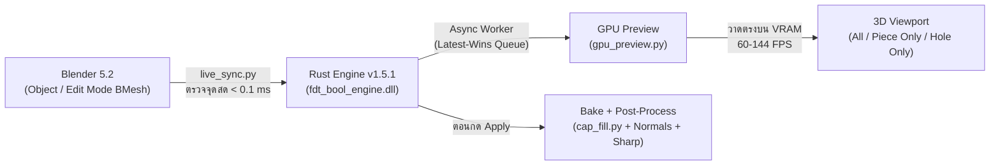

# ระบบ Rust Boolean Engine v1.5 และ GPU Preview

กลับไปที่ [[00_Home]] | ดูระบบปิดหน้าตัดต่อที่ [[ระบบปิดหน้าตัด_และ_ปิดผิวทะลุอัตโนมัติ]]

![[rust_engine_gpu_pipeline.jpg]]

> [!info] ทำไมต้องสร้าง Rust Engine + GPU Preview เอง?
> Boolean เดิมของ Blender เวลาตัดตึกที่มีหลายพันโพลีกอนมักช้า กระตุกตอนลากกล่อง ทำ Quad แตกเป็นสามเหลี่ยมมั่ว และทำให้ **Custom Split Normals** กับ **Sharp Edges** ของโมเดลตึกสำหรับเกม (Game-Ready Assets) เพี้ยนจนผิวดูมืดหรือเบี้ยว
> เราจึงสร้างเอนจินตัดด้วยภาษา Rust (`bin/fdt_bool_engine.dll`) คู่กับตัววาดภาพบนการ์ดจอโดยตรง (`core/gpu_preview.py`) ทำให้ลาก/แก้กล่องตัดได้ลื่น **60–144+ FPS** โดยที่ผิวตึกยังโชว์ Texture จริงครบทุกชั้น

---

## ผังการทำงานทั้งหมด (Pipeline Overview)

---

## 1. Rust Boolean Engine v1.5.1 (`fdt_bool_engine.dll`)

หัวใจหลักที่ทำให้รอยตัดคม สะอาด และไม่พังบนตึกเกมที่ไม่ได้ปิดตัน 100%:

1. **คงรูปเดิม 100% (`HybridMesh`)**:
   - หน้าไหนที่ไม่โดนกล่องตัด จะคงรูป **Quad / N-gon เดิม**, **UVMap0 + UVMap1**, และ **Custom Split Normals** ไว้เหมือนเดิมทุกบิต
   - หน้าที่โดนตัดแบ่ง จะคำนวณแทรกค่า UV และ Normal แบบ Barycentric อย่างแม่นยำ
2. **สร้างหน้าตัดด้วย 2D CDT (`spade` Constrained Delaunay Triangulation)**:
   - แทนที่การหั่นเส้นตรงแบบเก่า (BSP) ซึ่งเคยทิ้งสามเหลี่ยมยื่นแหลมกลางห้องใต้หลังคา
   - ใช้ **2D Harmonic Diffusion** + **Iterative Fin Pruning** ตัดครีบสามเหลี่ยมที่ยื่นออกสู่อากาศทิ้งอัตโนมัติ และอุดรูเข็มเล็กๆ (`Pinhole Closing`) บนหน้าตัดให้สนิท
3. **คำนวณแบบเบื้องหลัง (Async Latest-Wins)**:
   - ส่งงานให้ Rust คำนวณบน Thread แยก ไม่บล็อกหน้าจอ Blender (Main thread ใช้เวลาส่งขึ้นการ์ดจอแค่ `~1–2 ms`)

---

## 2. Zero-Switch Textured GPU Preview (`core/gpu_preview.py`)

ระหว่างลากหรือปรับกล่องตัด จะไม่สลับกลับไปเป็นโมเดลสีเทาเรียบๆ แต่จะวาด Texture จริงของตึกบนการ์ดจอทันที:

- **รองรับ Multi-Layer PBR Shader (สูงสุด 4 ชั้น)**:
  - โหลด Texture 6 ช่องครบ (Albedo Layer 1–4 บน `UV0` + RGB Mask Map และ Global Tint/Detail Map บน `UV1`) พร้อมค่าสี Tinting, UV Tiling/Offset และ Overlay Blend ผ่าน `GPUUniformBuf` ขนาด 272 ไบต์
  - แคชไว้ใน `_MAT_CACHE` เพื่อไม่ให้โหลดซ้ำทุกเฟรม
- **สลับมุมมองได้ทันทีแบบ 0 ms (`Preview View`)**:
  - **`All`**: แสดงตึกหลัก + ชิ้นที่ตัด + กล่องตัด
  - **`Piece Only`**: แสดง **เฉพาะชิ้นที่ตัดของ Zone ที่เลือกกล่องอยู่** (กด `Shift+คลิก` เพื่อดูหลาย Zone พร้อมกันได้) ส่วนกล่อง Zone อื่นจะหรี่เส้นจางลง
  - **`Hole Only`**: แสดงเฉพาะตัวตึกหลักที่มีรูแหว่ง + กล่องตัด
  - ทั้งหมดแค่สลับ `if` ในตัววาดการ์ดจอ **ไม่คำนวณ Rust ใหม่เลย** (รวมถึงการเปิด/ปิด `Zone Grid`)

---

## 3. การปรับกล่องตัดใน Edit Mode แบบเรียลไทม์

- **อ่านจุดสดจาก Edit Mode (`live_sync.py` + `rust_bridge.py`)**:
  - ปกติใน Blender ข้อมูล `obj.data` จะยังไม่อัปเดตจนกว่าจะออก Edit Mode
  - ระบบจึงอ่านพิกัดสดจาก `bmesh.from_edit_mesh(obj.data)` ส่งเข้า Rust โดยตรงผ่าน `bmesh_to_input()` ทำให้ดึงหน้า/เบเวล/ปรับรูปกล่องใน Edit Mode แล้ว **พื้นที่สีเหลือง (Zone Grid) และรอยตัดขยับตามทันที**
  - กด **Apply** จากใน Edit Mode ได้เลย (ระบบจะสลับกลับ Object Mode เพื่อบันทึกจุดให้ก่อนอบชิ้นงาน)
- **มองเห็นจุดกลางหน้า (`*`) ชัดไม่โดนตึกบัง**:
  - ตอนอยู่ใน Object Mode: เส้นกล่องจะถูกบังตามความลึกจริง (`show_in_front = False`) ไม่รกสายตา (เห็นทะลุเฉพาะตอนเปิด X-Ray `Alt+Z`)
  - ตอนเข้า **Edit Mode ของกล่องตัด**: ระบบเปิด `show_in_front = True` อัตโนมัติ และวาด **จุดกลางหน้า (`*`), เส้นขอบ, จุดมุม และสีส้มอ่อนบนหน้าที่เลือก** ลอยทับด้านหน้าตึก ทำให้คลิกเลือกหน้าของกล่องตัดได้ง่ายในคลิกเดียว

---

## โน้ตที่เกี่ยวข้อง
- [[โครงสร้างระบบทั้งหมด]]
- [[ระบบปิดหน้าตัด_และ_ปิดผิวทะลุอัตโนมัติ]]
- [[Apple_Bite_v2]]
- [[ข้อควรระวัง_Blender_5_2]]
