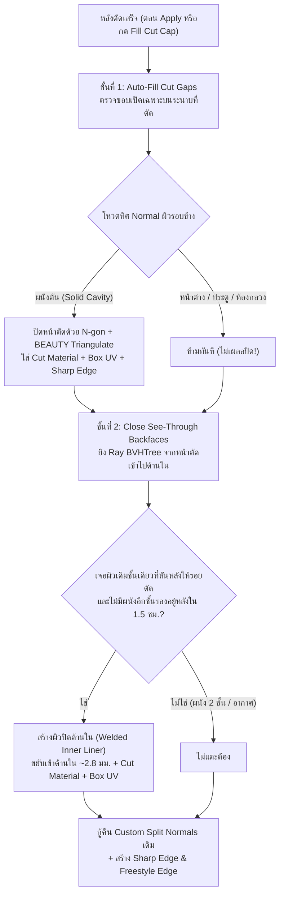

# ระบบปิดหน้าตัด และ ปิดผิวด้านในที่มองทะลุอัตโนมัติ

กลับไปที่ [[00_Home]] | ดูเอนจินตัดที่ [[ระบบ_Rust_Engine_และ_GPU_Preview]]

![[cap_fill_and_backface_liner.jpg]]

> [!info] ปัญหาจริงของโมเดลตึกสำหรับเกม (Game-Ready 3D Assets)
> โมเดลตึกสำหรับลงเกมมักไม่ได้สร้างเป็นก้อนตัน 100% เพื่อประหยัดโพลีกอน โดยเฉพาะ **ห้องใต้หลังคาที่ปิดทึบอยู่เดิม**:
> - ผนังด้านนอกและผนังกั้นห้องมีแค่ **ผิวชั้นเดียว** (หันหน้าออกนอกอย่างเดียว)
> - Material ในเกมเปิด **Backface Culling (`use_backface_culling = True`)**
>
> พอเราตัดเปิดเข้าไปในห้องใต้หลังคา จึงเกิดปัญหา 2 แบบ:
> 1. **รูหน้าตัดบางช่องปิดไม่สนิท** (ตรงจุดที่โครงสร้างซับซ้อนหรือมีเส้นขาด)
> 2. **มองเข้าไปในช่องใต้หลังคาแล้วทะลุเห็นฟ้า** (เพราะเรามองโดนด้านหลังของผิวชั้นเดียว)

---

## ระบบแก้ปัญหา 2 ชั้นใน `core/cap_fill.py`

---

## 1. ปิดรูหน้าตัดอัตโนมัติ (`Auto-Fill Cut Gaps`)

- **ตรวจเฉพาะบนระนาบที่ตัดจริง**: ไม่ไปยุ่งกับขอบเปิดส่วนอื่นของตึก
- **แยกผนังตัน vs ช่องหน้าต่าง/ห้องกลวง**:
  - คำนวณทิศ Normal ของผิวรอบขอบรู ถ้าผิวรอบๆ หันออกนอก (เนื้อตันอยู่ด้านในรู) → **ปิดให้**
  - ถ้าผิวรอบๆ หันเข้าในรู (เช่น ห้องกลวง หรือช่องหน้าต่าง/ประตู) → **ไม่ปิดเด็ดขาด**
- **หันทิศ Normal ออกนอกอัตโนมัติ (`_orient_desired_normal_for_cycle`)**: ดูจากฝั่งที่เนื้อผนังวางอยู่ ทำให้หน้าตัดไม่เคยกลับด้าน
- **กันรอยแตกตรงจุดเรียงเป็นเส้นตรง (T-Junctions)**: ใช้การสร้าง N-gon ครบทุกจุดขอบแล้ว `triangulate(..., ngon_method="BEAUTY")` แทนการตัดหูแบบธรรมดา ทำให้ไม่มีรอยแตกหรือขอบเปิดค้าง

---

## 2. ปิดผิวด้านในที่มองทะลุ (`Close See-Through Backfaces`)

- **ยิง Ray 5 ทิศทาง (`BVHTree`) จากระนาบหน้าตัดเข้าไปในชิ้นงาน**:
  - หาเฉพาะผิวเดิม (`fdt_orig >= 0.5`) ที่โดน Ray ชนจาก **ด้านหลัง** (`ray_dir · face_normal > 0.08`)
  - ตรวจซ้ำว่าด้านหลังผิวนั้น **ไม่มีผนังอีกชั้นซ้อนอยู่ใกล้ๆ** (ระยะ `1.5 ซม.`)
  - จำกัดขอบเขตการยิงให้อยู่เฉพาะบริเวณกล่องตัด (ไม่ลามไปส่วนอื่นของตึกหลักที่ไม่ได้ตัด)
- **สร้างผิวด้านในเชื่อมมุมเนียน (Welded Even-Thickness Liner)**:
  - ขยับจุดเข้าด้านในตามค่าเฉลี่ย Normal ประมาณ **`~2.8 มม.`** (`max(0.002, diag * 4e-4)`) → กันภาพกะพริบ **Z-Fighting** ในเกมได้ 100% และมุมชนกันสนิทไม่แตก
  - บังคับไม่ให้จุดโผล่เลยระนาบหน้าตัดออกมา
  - ใส่ **Cut Material + World-Space Box UV** (ลายไม่ยืดเป็นเส้น!) และติดป้าย `fdt_orig = 0.0` เพื่อให้กดเปลี่ยน Cut Material ทีหลังได้พร้อมกัน
- **กดซ้ำได้ปลอดภัย 100% (Idempotent)**: รันรอบที่ 2 Ray จะชนผิวด้านในที่เราเพิ่งสร้าง (หันหน้าออกถูกด้านแล้ว) → ได้ `0` หน้าซ้ำ

---

## 3. วิธีใช้งาน (ทั้งอัตโนมัติ และ ปุ่มกดเองทีหลัง)

| วิธีใช้ | อยู่ที่ไหน | ทำอะไรให้บ้าง |
| :--- | :--- | :--- |
| **อัตโนมัติตอน Apply** | Step 3 → ติ๊ก `Auto-Fill Cut Gaps` และ `Close See-Through Backfaces` *(เปิดเป็นค่าเริ่มต้น)* | ปิดทั้งรูหน้าตัด + ปิดผิวด้านในที่ทะลุให้ครบก่อนจบงาน |
| **กดปิดเองใน Object Mode** | เลือกชิ้นที่ตัดแล้ว → กด **`Fill Cut Cap (Auto)`** | สแกนระนาบหน้าตัดที่มีอยู่แล้ว แล้วปิดทั้งรูหน้าตัด + ผิวทะลุในคลิกเดียว |
| **กดปิดเองใน Edit Mode (เลือกขอบ)** | เข้า Edit Mode → เลือกเส้นขอบรอบรู → กด **`Fill Selected Cut Cap`** | ปิดรูที่เลือก พร้อม Cut Material + Box UV + หัน Normal ถูกด้าน + ไม่ทำ Normal เดิมเพี้ยน |
| **กดปิดเองใน Edit Mode (เลือกผิว)** | เข้า Edit Mode → เลือกผิวชั้นเดียวที่ทะลุ → กด **`Fill Selected Cut Cap`** | สร้างผิวปิดด้านหลังให้เฉพาะหน้าที่เลือก พร้อม Box UV + Cut Material |

> [!tip] การรักษาแสงเงา (Custom Split Normals & Sharp Edges)
> ทุกครั้งที่ปิดหน้าตัด ระบบจะ Snapshot ค่า `mesh.corner_normals` เดิมเก็บไว้ใน Attribute ชั่วคราวก่อนแก้ BMesh แล้วกู้คืนด้วย `normals_split_custom_set()` พร้อมสร้าง `sharp_edge` ตรงรอยต่อหน้าตัด ทำให้ผนังตึกเดิมไม่เคยมืดหรือเบี้ยวหลังอุดรูครับ

---

## โน้ตที่เกี่ยวข้อง
- [[ระบบ_Rust_Engine_และ_GPU_Preview]]
- [[Apple_Bite_v2]]
- [[ข้อควรระวัง_Blender_5_2]]
- [[บันทึกผลทดสอบแต่ละเฟส]]
