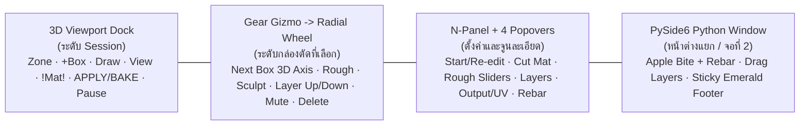

# รายงานการ Redesign UI — 3D-Viewport-First & Minimal

กลับไปที่ [[00_Home]] | ดูโครงสร้างรวม [[โครงสร้างระบบทั้งหมด]]

> [!info] เป้าหมายของการ Redesign
> ยกเครื่องหน้าตา **FullDestruc_Tool** ใหม่ทั้ง 3 พื้นผิว (**3D Viewport**, **N-Panel** และ **PySide6 Python Window**) ให้ **ใช้งานใน 3D Viewport เป็นหลัก** ลดการหันไปเลื่อนดู N-Panel, ทำให้ปุ่ม **APPLY / BAKE เด่นสะดุดตา**, ใช้ **ชุดไอคอนสี Flat 38 ตัว** แยกหมวดหน้าที่ชัดเจน และวางระบบป้องกันความผิดพลาดเวลาทำงานนอกกรอบ/ย้อนขั้นตอน

![[ui_redesign_viewport_dock.png]]

---

## 1. ตารางเปรียบเทียบ ก่อน vs. หลัง Redesign

| หัวข้อ | ก่อน Redesign (เดิม) | หลัง Redesign (ใหม่) |
| :--- | :--- | :--- |
| **การทำงานใน 3D Viewport** | ไม่มีแถบ Session ต้องหันไปกด Zone / Add / View / Apply ใน N-Panel บ่อย | มี **Floating Action Dock** ลอยขอบล่างกลางจอเฉพาะตอน Active (Idle โล่ง 100%) |
| **ความสูงของ N-Panel (Active)** | ~35 แถว (ยาวเกือบ 2 หน้าจอ ต้อง scroll ขึ้นลงตลอด) | **~10 แถว จบใน 1 หน้าจอ** ไม่ต้อง scroll |
| **แถบไอคอนซ้าย (Zen UV Rail)** | `split(factor=0.16)` เหลือช่องว่างกว้างเกินความจำเป็น + ไอคอนขาวดำ | ล็อกความกว้างพอดีตัว (`ui_units_x = 1.35`) + **ไอคอนสี Flat** |
| **ส่วนเลือก Zone** | กินพื้นที่ 5 แถว (Grid A-H + Dropdown + ปุ่ม New/Rename/Delete ปน Object Rename) | ยุบเหลือ **1 แถว** (`● จุดสี + ช่องค้นหา + Popover Zones`) แยก `Rename Object` ออกชัดเจน |
| **Engine / Rough / Output & UV** | กางเต็มหน้าจอทุกตัว | ซ่อนอย่างเป็นระเบียบใน **4 Popover Panels** (`Settings`, `Zones`, `Rough`, `Output`) |
| **รายการ Cutter Layers** | กางค้างไว้ 8 แถวตลอดเวลา | พับเริ่มต้น (`▸ Layers (N)`) คลิกกางดูได้ทันทีเมื่อต้องการ |
| **ปุ่ม APPLY / BAKE** | ปุ่มสีเทาธรรมดา ถูกดันจมอยู่ล่างสุดของ N-Panel | **แคปซูลสีเขียวมรกตเด่น** ใน 3D Viewport & Sticky Footer ของ Qt + ปุ่มสูง `scale_y = 1.7` พร้อมไอคอนเขียวใน N-Panel |
| **ภาษาบน UI** | ปนกันระหว่างไทยกับอังกฤษในป้ายปุ่ม | ป้ายปุ่ม/หัวข้อ **อังกฤษสั้นกระชับเหมือนกันทุกหน้า** + คง **Tooltip ภาษาไทย** ครบทุกตัว |
| **ความปลอดภัยเมื่อกด Cancel** | กดพลาดทีเดียวลบกล่องตัดทั้งหมด (และลบ `FDT_Final` ตอน Re-edit) ทันที | มี **Confirm Dialog อัจฉริยะ** (0 กล่องยกเลิกทันที / ≥1 กล่องถามก่อน / Re-edit เตือนสีแดง) + แถบ Dock Phase B มีแค่ `Pause` ปลอดภัย |

---

## 2. การแบ่งหน้าที่ของแต่ละหน้าต่าง (Clear Mental Model)

---

## 3. ระบบ Custom Colored Flat Icons (38 ไอคอน)

สร้างด้วยสคริปต์ `scripts/generate_icons.py` (วาด 4× Supersampling → 64×64 RGBA PNG เก็บใน `addon/resources/icons/`) และโหลดผ่าน `addon/ui/icons.py` (`bpy.utils.previews` + fallback อัตโนมัติเวลาเทสต์แบบ headless) ใช้ชุดสีเดียวกันทั้ง N-Panel, PySide6 (`QIcon`) และ 3D Viewport Dock:

![[ui_redesign_icons_palette.png]]

| บทบาท (Semantic Role) | สีหลัก | Hex | ใช้กับ |
| :--- | :--- | :--- | :--- |
| **Commit / Primary** | Emerald Green | `#2ED47A` | `APPLY`, `BAKE`, Ready Check |
| **Create / Cut** | Amber Orange | `#F59E0B` | แท็บ `Apple Bite`, `Start Cut`, `+ Box`, `+ Mesh`, `Re-apply` |
| **Freehand / Sculpt** | Rose Pink | `#F43F5E` | `Draw Cutter`, `Draw Sculpt` |
| **Fracture / Rough** | Vivid Purple | `#A855F7` | `Rough Cut Edge` |
| **View / Rebar / Grid** | Sky Cyan | `#38BDF8` | แท็บ `Rebar`, `View Mode`, `Zone Grid`, `Click Place`, `Re-edit` |
| **Cleanup / Material** | Teal | `#14B8A6` | แท็บ `Cleanup`, `Eyedropper`, `Fill Cap`, `Output` |
| **Alert / Danger** | Soft Red | `#EF4444` | `! Mat!`, `Cancel & Restore`, `Delete`, `Reset to Original` |
| **Neutral / Utility** | Cool Slate | `#94A3B8` | `Pause`, `Settings`, `Window`, `Layers`, `Batch` |

---

## 4. รายละเอียดแต่ละส่วนที่พัฒนาใหม่

### 4.1 3D Viewport Floating Action Dock (`addon/ui/viewport_hud.py`)
- **สถาปัตยกรรม Hybrid (2D Hit-Test Gizmo + `POST_PIXEL` Renderer)**:
  - `FDT_GT_dock_pill` (`bpy.types.Gizmo`) ทำหน้าที่รับคลิกแบบกรอบสี่เหลี่ยมมน (`test_select`), แสดง Tooltip native ของ Blender และส่งคำสั่งผ่าน `target_set_operator` โดยไม่บล็อก `G/R/S`, MMB Orbit, Undo หรือ Edit Mode
  - `_draw_dock_post_pixel` (`SpaceView3D.draw_handler_add(..., "POST_PIXEL")`) วาดภาพทั้งหมดเรียงลำดับจากหลังมาหน้า (แคปซูลกระจกมืด → เส้นคั่น → ปุ่มสี/ไอคอน → ตัวหนังสือ `blf`)
- **Progressive 2-Phase Disclosure**:
  - **Idle**: ซ่อนสนิท 100%
  - **Phase A (0 valid cutters)**: โชว์เฉพาะ `[● Zone] | [+ Add Box] [Draw] | [✕]` ซ่อน `View` และ `APPLY` เพื่อบอกก้าวถัดไปทันที
  - **Phase B (≥ 1 valid cutter)**: เปิด `[View]`, ปุ่มเตือนแดง `[! Mat!]` (โผล่เฉพาะตอนยังไม่ตั้ง `Cut Material` กดปุ๊บเปิดหลอดดูด 3D Eyedropper ทันที), แคปซูลเขียวมรกต **`[✓ APPLY · N]`** และปุ่ม **`[⏸ Pause]`** ที่ปลอดภัย
  - **Rebar Live / Stale**: โชว์ `[Rebar · ~N]`, ปุ่มส้ม `[Re-apply]` (เมื่อ host ถูกตัดใหม่จน stale), แคปซูลเขียวมรกต **`[✓ BAKE]`**, `[Edit]` และ `[🗑]`
- **DPI, Responsive & Modal Auto-Hide**:
  - ขยายขนาดตาม `preferences.system.ui_scale` อัตโนมัติ
  - จอแคบ (`region.width < 680 * ui_scale`) หดป้ายข้อความเป็นโหมดสั้นอัตโนมัติ
  - ซ่อนอัตโนมัติเมื่อเปิดโหมด Modal อื่น (`Click Place`, `Pick 3D Axis`, `Pick Layer`, `Radial Wheel`, `View Wheel`, `Draw Overlay`)

### 4.2 Minimal Single-Screen N-Panel (`addon/ui/panel_n.py` & `panel_rebar.py`)
- **4 Popover Panels** (แยกของที่ปรับนาน ๆ ครั้งออกจากหน้าหลัก):
  1. `FDT_PT_popover_settings` — Boolean Engine (`Rust / Exact / Float`), `GPU Fast Drag`, เปิด/ปิด `3D Viewport Dock`, `Quick Tune`, `Debug Window`
  2. `FDT_PT_popover_zones` — Quick Grid A–H + ปุ่ม `New / Edit / Delete` Zone Registry ชัดเจน
  3. `FDT_PT_popover_rough` — เปิด/ปิด Rough + สไลเดอร์ `Inward Depth`, `Jaggedness`, `Noise Scale`, `Detail`, `Seed`
  4. `FDT_PT_popover_output` — `Texel / Size`, `Main Mesh / Zone Pieces`, `Auto-Fill Cut Gaps`, `Close See-Through Backfaces`, `Fill Cap`, `Rename Obj`
- **Rebar Panel (`panel_rebar.py`)**:
  - ซ่อนปุ่ม `Edit / Faces / Clear / Remove` ตอน Idle (ยังไม่สร้างชุดเหล็ก) และย้าย `Label` ไปไว้ใน `Look`
  - เพิ่ม **Global Stale Banner** ด้านบนสุดทันทีที่มี Rebar ค้าง stale แม้จะพับ `System & Sets` ไว้

### 4.3 PySide6 Companion Window (`addon/ui/qt_window.py`)
- โฉมใหม่โทน Dark Slate (`#16181e` / `#1e212a`) ใช้ไอคอนสี PNG ชุดเดียวกัน
- เพิ่มแถบสลับ **Apple Bite | Rebar** ด้านบน + ลิ้นชัก `⚙ Settings` แบบพับได้
- คงระบบลากสลับชั้น `CutterLayerListWidget` (พับเริ่มต้น) และ **Sticky Emerald Footer** ล็อกปุ่ม `APPLY` / `BAKE` ไว้ล่างสุดนอก Scroll Area ตลอดเวลา

---

## 5. เกราะป้องกัน Workflow นอกกรอบ (Audit Guards)

> [!tip] สิ่งที่ตรวจพบจากการ Audit 3 รอบและใส่เกราะป้องกันครบทุกจุด
> 1. **นับเฉพาะกล่องตัดที่ยังมีตัวตนจริง (`session.get_valid_cutters()`)** — ถ้าผู้ใช้กด `X` ลบกล่องเองใน Blender แถบ Dock จะสลับกลับเป็น Phase A อัตโนมัติ ไม่มีเลขผีค้าง
> 2. **แยกปุ่ม `Re-edit Cut` (ฟ้า) กับ `Cut Further` (ส้ม) คู่กันชัดเจน** บนชิ้นงานที่ Apply แล้ว ลดโอกาสเผลอกดเปิด Session ซ้อนโดยไม่ตั้งใจ
> 3. **กันกด Apply พลาดเมื่อ All Muted หรือ Output = None** — ปิดปุ่มชั่วคราวพร้อมแจ้งเตือนสาเหตุทันที
> 4. **Confirm Dialog ของ `Cancel & Restore`** — เตือนสีแดงชัดเจนหากกำลัง Re-edit งานที่ Apply ไปแล้ว เพราะการ Cancel จะลบทั้งกล่องตัดและ `FDT_Final` กลับไปเป็นตึกต้นฉบับ

---

## 6. บันทึกการแก้บั๊กหลังทดสอบจริงใน Blender 5.2

> [!warning] บั๊กที่เจอตอนทดสอบจริงและแก้ปิดเรียบร้อยแล้ว
> - **บั๊กแถบ Dock มีลายเส้นสามเหลี่ยมพาดทับและสีเพี้ยน (`e0b2ecc`)**: เกิดจากการวาด GPU/BLF ข้างใน `Gizmo.draw()` ทำให้ลำดับการวาดสลับกับ state ของ Gizmo pass → **แก้โดย**ย้ายการวาดทั้งหมดไปที่ `POST_PIXEL` draw handler และให้ `FDT_GT_dock_pill` ทำเฉพาะ hit-test/tooltip
> - **บั๊กช่องว่างส่วนเกินใน N-Panel (`226d0e8`)**: `split(factor=0.16)` เหลือช่องว่างหลังแถบซ้าย และป้าย `"Mat:"` ดันช่องเลือก Material แคบ → **แก้โดย**ใช้ `row()` + `rail.ui_units_x = 1.35`, ถอดป้าย `"Mat:"` ออก (`text=""`) และล็อกความกว้างจุดสี Zone ที่ `ui_units_x = 1.1`
> - **บั๊กกดปุ่ม `View` บน Dock แล้ววงล้อไปโผล่มุมซ้ายล่าง (`8d745dd`)**: `FDT_OT_view_mode_wheel_menu.invoke()` ใช้ค่าเริ่มต้น `cx=0, cy=0` → **แก้โดย**ใช้พิกัดเมาส์เมื่อไม่ได้ส่ง `cx/cy` พร้อม Clamp ให้อยู่ในกรอบ 3D Viewport เสมอ

---

## 7. ไฟล์ที่สร้างและแก้ไข + การทดสอบ

- **สร้างใหม่**: `scripts/generate_icons.py`, `addon/resources/icons/*.png` (38 ไฟล์), `addon/ui/icons.py`, `addon/ui/viewport_hud.py`, `tests/test_ui_redesign.py`
- **ปรับปรุงหลัก**: `addon/ui/panel_n.py`, `addon/ui/panel_rebar.py`, `addon/ui/qt_window.py`, `addon/ui/wheel_menu.py`, `addon/ui/cutter_gizmo.py`, `addon/ui/floating_menu.py`, `addon/ui/__init__.py`, `addon/ops/apple_bite_ops.py`, `addon/ops/material_picker.py`, `addon/props.py`
- **ชุดทดสอบอัตโนมัติ**: เพิ่ม `tests/test_ui_redesign.py` เข้า `tests/run_tests.py` ครอบคลุมการตรวจไอคอน 64×64 PNG, โหมด Phase A/B/Rebar, Responsive & HiDPI, All-Muted/Output-None Guards และ Popovers

## โน้ตที่เกี่ยวข้อง
- [[00_Home]]
- [[โครงสร้างระบบทั้งหมด]]
- [[ระบบเชื่อมหน้าต่าง_PySide6]]
- [[Apple_Bite_v2]]
- [[Rebar]]
- [[บันทึกผลทดสอบแต่ละเฟส]]
